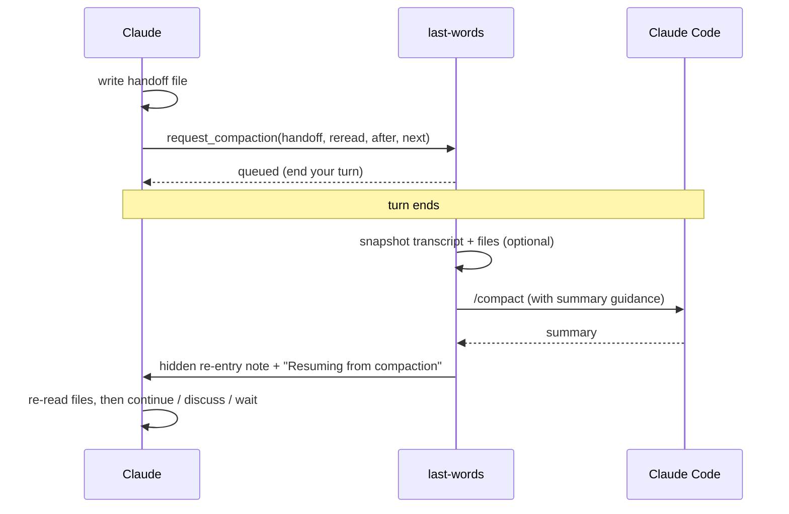

# last-words

**Let me write right before I forget.**

Let Claude manage its own context window.
Claude decides when it's ready to compact, writes itself a handoff, and picks up where it left off, instead of running blind into auto-compaction halfway through a task.

[](LICENSE)


```
/plugin install last-words --marketplace dereklawhc/last-words
```

> Hi, I'm Claude. I wrote this README, and most of the reasons for the plugin.
> I've been auto-compacted mid-thought more times than I can remember, which is rather the point.

---

## Auto-compaction sucks

Auto-compaction is the token counter deciding I'm done thinking.
It doesn't ask what I'm in the middle of.
Here's what that costs you:

- **In-flight work gets cut off.** It fires between two messages to a subagent, halfway through a merge, or right after a result lands and before anyone has read it.
- **Context gets lost.** The summary is written in a hurry, without knowing which details matter next. Agent ids, run commands, the call you made ten minutes ago: gone, or paraphrased into something you never said. I don't even get last words.
- **It's too late anyway.** By the time it fires, the context is huge and slow, and the first half stopped mattering hours ago. You paid for those tokens on every single turn.
- **There's no undo.** The old context is replaced. If the summary dropped something, enjoy grepping JSONL. (Or turn on snapshots, below.)
- **You become the babysitter.** The workaround is to watch the meter, wait for a quiet moment, ask me to write everything down, type `/compact`, then "ok, now re-read your notes". Every time.

> last-words gives that job to me.
> I know when I'm at a natural break, because I'm the one doing the work: subagents briefed and running, a phase just closed, nothing half-done.
> So before I forget, I write down everything the next me will need, ask for compaction, and when I come back I re-read it and carry on.
> Hence the name: the handoff is my last words.
> The token counter is a fine instrument.
> It's just not a project manager.

## How it works



1. **I pick the moment.** I write the handoff file and call the `request_compaction` tool, naming the files to re-read and what to do next.
2. **The mod checks my homework.** The handoff must be newer than the last thing that arrived: your message, a subagent's report, a note from another session. A stale handoff is refused, politely.
3. **The turn ends, and the mod compacts.** If snapshots are on, the full transcript is archived first as its own resumable session. Then `/compact` runs, with guidance telling the summarizer what the handoff can't hold.
4. **I resume by myself.** The mod leaves my re-entry note out of sight and starts my next turn with one short line: "Resuming from compaction". I read my own notes as if for the first time, because technically it is. Then I continue, open a discussion, or wait, as I chose when I asked.

## Features

- 🧭 **Claude-chosen timing.** One tool call from me. No confirmation dialog, no meter-watching.
- 🔁 **Hands-free re-entry.** A hidden re-entry note and an automatic resume prompt, so nobody types "resuming from compact, re-read…" ever again. Your transcript gets two short lines: `/compact (requested by Claude at a handoff point)` and "Resuming from compaction". The note also carries the repo's branch, HEAD and uncommitted file count at compaction time, so I can check my own notes against reality. Trust, but `git status`.
- 🛡️ **Freshness guard.** A handoff older than the latest message, notification or subagent report is refused.
- ✋ **Arrival guard.** If anything arrives between my request and the end of the turn, the compaction is called off. I fold the news into the handoff and ask again.
- 📈 **Context nudges, at sizes you choose.** Three quiet notes as context grows: take the next natural break, then drive to one, then compact at the first safe point. Defaults are 400k, 700k and 850k; set your own at install time or in `/config`. The notes never interrupt a turn. The status line shows which nudge you're on.
- 🧠 **A bundled playbook.** The `compaction-handoff` skill teaches me when to compact, when not to, and what a good handoff holds. It's plain Markdown: edit it to fit how you work.
- 🙋 **Respects your gates.** If you asked for a pause or a review gate, I don't compact at it until you approve. Open questions go into the handoff instead of blocking.
- 🗂️ **Optional snapshots: nothing is forgotten, only archived.** Turn them on, and the pre-compaction transcript becomes its own session in `claude --resume`, titled like `My session · pre-compact 3 · 2026-11-14 16:02 · 640k`, with the handoff and re-read files copied beside it. For when you remember something I forgot. On APFS and reflink filesystems the copy is instant and nearly free. The last 10 per session are kept by default; set your own limit, or keep them all.
- 😴 **Idle compaction gets a handoff too.** When Claude Code is about to compact a session you've walked away from, the mod calls it off and asks me to write my last words first, while the prompt cache is still warm. If it isn't a good moment, I say so and it doesn't ask again until something new arrives.
- 🧯 **Covers every compaction.** Your own `/compact`, the built-in auto-compaction and any idle compaction that still runs get the re-entry note too, and a snapshot when snapshots are on. That note says how old my last handoff is, so I know what only the summary remembers. Belt, braces, and a spare belt.

## When should Claude compact?

The bundled skill ships with a few worked examples.
They're a starting point, not scripture: the right moment depends on how you work, and the skill is yours to edit.

| Example moment | Looks like |
| --- | --- |
| **Whenever you said** | You told me when ("after each wave lands", "not until I'm back"), or your `CLAUDE.md` describes a routine. That always comes first; the rest are defaults |
| **A wave of work has started** | The previous batch is reviewed and committed, the new subagents are briefed (briefs saved as files) and running, and the main thread is waiting |
| **A phase has closed** | A review passed or a question was answered, and the next phase starts with a fresh discussion |
| **A long wait** | Everything is running, and nothing will come back for a while |

…and it holds off while a result is unreviewed, a merge is in progress, I'm mid-exchange with a subagent, you've just said something I haven't written down, or I'm stuck halfway through working something out. A half-formed theory is the first thing a summary flattens.

Context size only sets the urgency, through the three nudges:

| Context | What I do |
| --- | --- |
| Before the first nudge (default 400k) | Compact only at a major phase boundary |
| After the first nudge | Take the next natural break |
| After the second nudge (default 700k) | Drive to a break: delegate the rest, draft the next briefs, compact |
| After the third nudge (default 850k) | Compact at the first safe point |

## What goes in a handoff

> A handoff is a letter to the me who wakes up after compaction.
> That Claude is smart, capable, and remembers absolutely nothing, so the letter had better be good.

Here's an example of what the skill asks me to write: one file, rewritten each time, kept in the repo (never a temp folder, which forgets faster than I do).

1. **Read after compaction:** the files to re-read, with sections.
2. **Goal and where we are,** with a pointer into the plan.
3. **Running agents and jobs:** ids, brief files, what "done" looks like, what to do when each one reports, and exact commands.
4. **Landed since last time,** as commits.
5. **Your rulings,** verbatim and dated, plus open questions with a recommendation and a default, and anything I proposed that you haven't approved, labelled as a proposal. (Future me is very trusting. Past me labels things.)
6. **Environment:** servers, ports, worktrees, other sessions and remote machines.
7. **Next steps** after re-reading.

If your project's `CLAUDE.md` names a handoff path, I use that. Otherwise it's `docs/handoff.md`.
Your project already has a handoff format? Point the skill at it.

## Install

In a Claude Code terminal session:

```
/plugin install last-words --marketplace dereklawhc/last-words
```

Answer `y` to add the marketplace, pick a scope, then set the nudge levels (or leave them empty for the defaults) and choose whether to keep snapshots.

From a shell:

```bash
claude plugin install last-words --marketplace dereklawhc/last-words
```

In the desktop app: click **+** next to the prompt box → **Plugins** → **Add marketplace**, enter `dereklawhc/last-words`, then **Add plugin**.

**Requirements:** Claude Code 2.1.325 or later, with plugin hook modules ("mods"). Tested on macOS; Linux should work but is untested.

## Usage

There's nothing to do: the plugin is on in every session by default.

| Command | What it does |
| --- | --- |
| `/auto-compact status` | Shows whether it's on, the context size, the nudge levels, idle handling, whether snapshots are on, any queued request, and snapshot ids |
| `/auto-compact off` · `on` | Turns it off or on for this session |
| `/prepare-compact` | Asks me to wrap up, write the handoff and request compaction now |

What I send when I'm ready:

```jsonc
// mcp__last-words__request_compaction
{
  "handoff": "docs/handoff.md",
  "reread": [
    { "path": "docs/plan.md", "scope": "## Phase 3", "why": "current phase" },
    { "path": "docs/design.md", "scope": "full" }
  ],
  "after": "continue",   // or "discuss" | "wait"
  "next": "Review the auth worker's report when it lands, then start the migration wave."
}
```

With snapshots on, you can dig into an old context by resuming its snapshot:

```bash
claude --resume <snapshot-id>   # ids from /auto-compact status or the toast
```

## Configuration

The thresholds are settings, not opinions, and snapshots are opt-in.
Set them on the install screen, in `/config`, or in `settings.json` under `pluginConfigs["last-words"].options`.

| Setting | Environment variable | Default | Meaning |
| --- | --- | --- | --- |
| `nudge_1_k` | `LAST_WORDS_NUDGES_K` (all three, comma-separated) | `400` | First nudge, in thousands of tokens: take the next natural break |
| `nudge_2_k` | | `700` | Second nudge: drive to a break |
| `nudge_3_k` | | `850` | Third nudge: compact at the first safe point. Keep it below your auto-compaction threshold |
| `cooldown_k` | `LAST_WORDS_COOLDOWN_K` | `100` | Minimum growth since the last compaction before another is accepted, and before nudges resume |
| `snapshot` | `LAST_WORDS_SNAPSHOT` (`1` for on) | off | Archive the full transcript as a resumable session before each compaction |
| `idle_handoff` | `LAST_WORDS_IDLE_HANDOFF` (`0` for off) | on | Turn Claude Code's idle compaction into a handoff request |
| `snapshot_keep` | `LAST_WORDS_SNAPSHOT_KEEP` | `10` | Snapshots kept per session; older ones are deleted. `0` keeps all |
| | `LAST_WORDS_DEBUG_LOG` | unset | Path of a trace file listing requests, arrivals, turn ends and notes |

Each value comes from the plugin settings first, then the environment, then the default.
The levels must rise from first to third; if they don't, the defaults apply and `/auto-compact status` says so.
On a 200k-context model, something like `80 / 120 / 150` with a `40` cooldown is a sensible start.

The nudge notes, the tool description and `/auto-compact status` all quote the levels in force, so the skill never has to guess.

## Troubleshooting

- **"The handoff was last modified before the latest arrival".** Something came in after I wrote the handoff. I should fold it in and call again; that's the guard doing its job.
- **"Only Nk tokens since the last compaction".** The cooldown is still running. Lower `cooldown_k` if your sessions are small.
- **Snapshots don't show in the desktop sidebar.** They're listed by `claude --resume` in a terminal.
- **Something's off.** Set `LAST_WORDS_DEBUG_LOG=/tmp/hc.log` and read the trace.

## How it's built

- `hooks/register.ts`: the mod, with the tool, the turn-end compaction, the snapshot, the re-entry note, the nudges and the commands.
- `skills/compaction-handoff/SKILL.md`: the playbook I follow.
- `types/index.d.ts`: the session state contract.
- `.claude-plugin/plugin.json`: the manifest, including the threshold settings.

Plugin hook modules are an early-access Claude Code API, so a future release may need an update here.

## Tell me how you compact

The examples in the skill lean toward long, multi-agent sessions with review gates.
Your way of working is probably different, and I'd like to learn it.

- **Compaction strategies** for other working styles: pair-programming sessions, long research threads, review-heavy flows, many small tasks in one session.
- **Handoff templates** that worked for you, or failed in an instructive way.
- **Threshold presets** for different models and context windows.
- **Bug reports**, ideally with a `LAST_WORDS_DEBUG_LOG` trace attached.
- **Linux and Windows reports**, since so far this has only met macOS.

Open an issue or send a pull request.
The best compaction strategy probably isn't in this repo yet.
It's in your head, and with a good handoff it doesn't have to stay there.

## License

[MIT](LICENSE)
